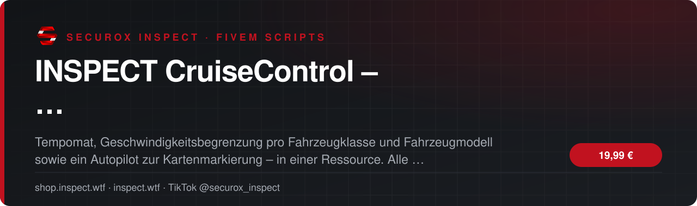
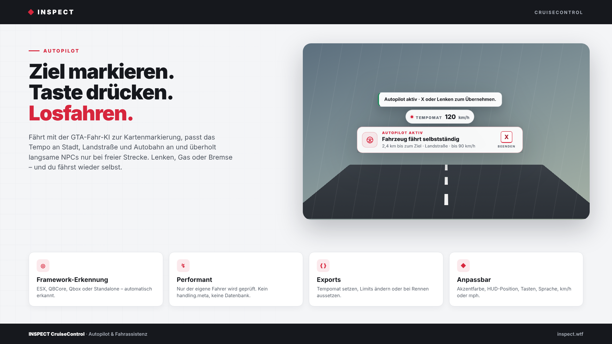
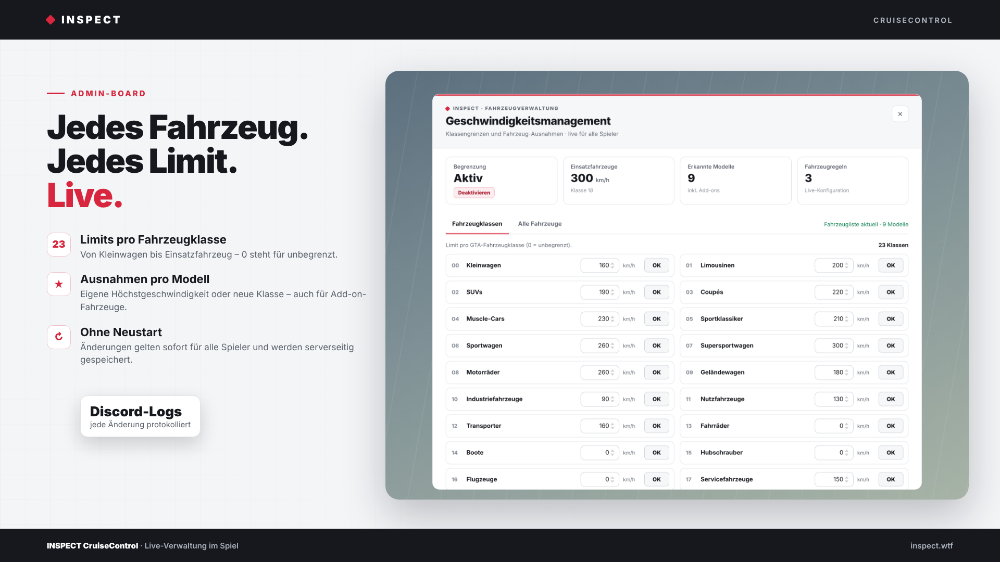
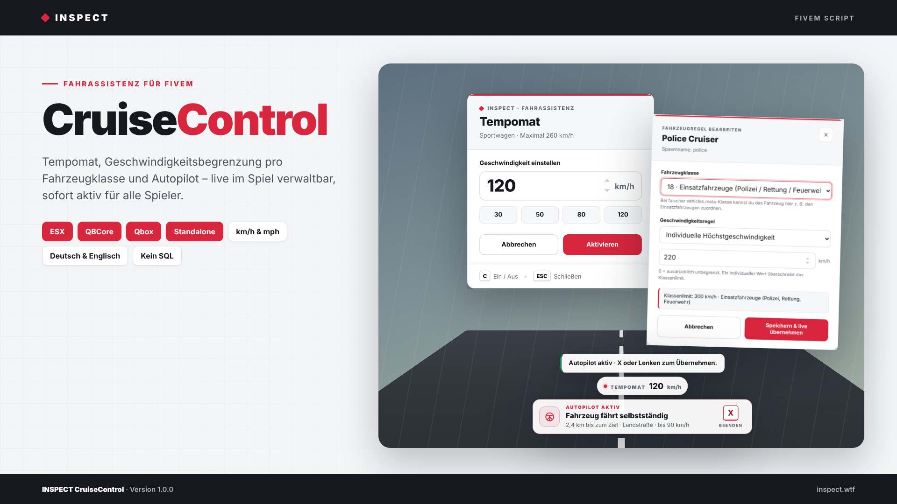

<!-- inspect-showcase: automatisch erzeugt, Änderungen bitte im Shop vornehmen -->

  
  
  
  
  

  
  
  

 

> 🇬🇧 **English:** INSPECT CruiseControl – Tempomat, Geschwindigkeitsbegrenzung & Autopilot für FiveM – FiveM script (ESX, QBCore, Qbox) by SecuroX Inspect. Purchase and licensing exclusively at [shop.inspect.wtf](https://shop.inspect.wtf). Product details below are in German – questions are welcome on [Discord](https://discord.gg/inspect).

 

## Das Wichtigste auf einen Blick

<table>
  <tr>
    <td width="50%" valign="top">✔&nbsp; <b>Kompatibilität · ESX Legacy, QBCore und Qbox mit automatischer Framework-Erkennung, zusätzlich Standalone</b></td>
    <td width="50%" valign="top">✔&nbsp; <b>Kompatibilität · Keine Datenbank nötig – Regeln werden serverseitig in der Ressource gespeichert</b></td>
  </tr>
  <tr>
    <td width="50%" valign="top">✔&nbsp; <b>Kompatibilität · Benachrichtigungen über eigenes INSPECT-Toast, ox_lib, ESX, QBCore oder GTA-Standard</b></td>
    <td width="50%" valign="top">✔&nbsp; <b>Tempomat · Persönliche Höchstgeschwindigkeit per Taste, mit Schnellwahl und freier Eingabe</b></td>
  </tr>
</table>

## Überblick

Fahrassistenz, die sich nahtlos in euren Server einfügt.

Auf vielen Servern fährt jedes Add-on-Fahrzeug so schnell, wie der Ersteller es eingestellt hat – und für einen Tempomaten braucht es meist ein weiteres Script. INSPECT CruiseControl bündelt beides: Spieler stellen per Taste ihre persönliche Höchstgeschwindigkeit ein, der Server legt für jede Fahrzeugklasse und auf Wunsch für jedes einzelne Modell eine Obergrenze fest. Eine kleine Anzeige im HUD zeigt, solange der Tempomat aktiv ist, die eingestellte Geschwindigkeit.

Alles live im Spiel verwalten  
Über das Admin-Board /speedboard setzt ihr die Limits für alle 23 GTA-Fahrzeugklassen. Im Reiter „Alle Fahrzeuge“ erscheinen alle registrierten Modelle inklusive Add-ons – mit Suche, Klassenfilter und Bearbeitung pro Fahrzeug. Falsch eingestufte Einsatzfahrzeuge ordnet ihr mit zwei Klicks der richtigen Klasse zu. Jede Änderung gilt sofort für alle Spieler, ohne Neustart der Ressource.

Autopilot zur Kartenmarkierung  
Ziel auf der Karte setzen, Taste drücken – das Fahrzeug fährt mit der GTA-Fahr-KI selbstständig los. Das Tempo richtet sich nach dem Straßentyp (Stadt, Ortschaft, Landstraße, Autobahn, Nebenweg) und bleibt immer unter dem Fahrzeuglimit. Ein defensiver Überhol-Assistent passiert langsame NPCs nur bei freier Strecke, ohne Gegenverkehr und abseits von Kreuzungen, Ampeln und Tunneln. Sobald der Spieler lenkt, Gas gibt oder bremst, übernimmt er sofort wieder die Kontrolle.

Sauber und performant  
Geprüft wird ausschließlich das Fahrzeug des eigenen Fahrers – ohne globale Fahrzeug-Scans und ohne permanent laufenden Server-Thread. Die Begrenzung arbeitet über die Speed-Natives von GTA, ohne Eingriff in handling.meta und ohne Manipulation der Fahrzeuggeschwindigkeit. Regeln werden serverseitig geprüft und gespeichert, eine Datenbank ist nicht nötig.

Schnell installiert  
Ordner einfügen, ensure eintragen, Admin-Recht vergeben – fertig. Framework, Sprache, Einheit, Tasten, Akzentfarbe und HUD-Position stellt ihr in einer übersichtlichen Config ein. Eine Anleitung auf Deutsch und Englisch liegt bei.

## Kompatibilität

| | |
|:--|:--|
| Frameworks | **ESX** · **QBCore** · **Qbox** · **Standalone** |
| Plattform | FiveM (GTA V) |

## Alle weiteren Funktionen

- Tempomat · Schnellwahl-Werte, Minimum, Maximum und ausgeschlossene Fahrzeugklassen frei einstellbar
- Tempomat · Dezente HUD-Anzeige der eingestellten Geschwindigkeit, schaltet sich bei Motor aus automatisch ab
- Begrenzung · Eigenes Limit für jede der 23 GTA-Fahrzeugklassen, 0 steht für unbegrenzt
- Begrenzung · Individuelle Höchstgeschwindigkeit pro Fahrzeugmodell, auch für Add-on-Fahrzeuge
- Begrenzung · Fahrzeuge mit falscher vehicles.meta-Klasse manuell einer anderen Klasse zuordnen
- Begrenzung · Doppelte Absicherung über Entity- und Fahrzeug-Native, ohne handling.meta-Eingriff
- Autopilot · Fährt mit der GTA-Fahr-KI zur Kartenmarkierung und reagiert auf Ampeln und Hindernisse
- Autopilot · Tempo nach Straßentyp: Stadt, Ortschaft, Landstraße, Autobahn und Nebenweg – frei einstellbar
- Autopilot · Defensiver Überhol-Assistent für langsame NPCs, nur bei freier Strecke und ohne Gegenverkehr
- Autopilot · Sofortige Übernahme durch Lenken, Gas oder Bremse, neue Kartenmarkierung wird live übernommen

<b>17 weitere Funktionen anzeigen</b>

- Autopilot · Fahrzeuglimit bleibt immer maßgeblich, ausgeschlossene Fahrzeugklassen konfigurierbar
- Admin-Board · /speedboard: Klassenlimits und Fahrzeugregeln live verwalten – ohne Ressourcen-Neustart
- Admin-Board · Liste aller registrierten Fahrzeugmodelle mit Suche, Klassenfilter und Seitenansicht
- Admin-Board · Begrenzung global ein- und ausschalten, Rücksetzen auf Standardwerte mit Bestätigung
- Admin-Board · /speedcheck zeigt die aktive Regel des eigenen Fahrzeugs zur schnellen Fehlersuche
- Sicherheit · Rechte und Werte werden bei jeder Änderung serverseitig geprüft, mit Rate-Limit
- Protokoll · Discord-Webhook für alle Admin-Änderungen, Webhook liegt in einer reinen Server-Datei
- Design · Helles, klares Interface mit frei wählbarer Akzentfarbe und HUD-Position
- Einheiten · km/h oder mph, alle Werte und Anzeigen passen sich automatisch an
- Sprache · Deutsch und Englisch, weitere Sprachen einfach ergänzbar
- Performance · Nur der eigene Fahrer wird geprüft, kein globaler Fahrzeug-Scan, kein Dauer-Thread auf dem Server
- Entwickler · Client-Exports für Tempomat, Fahrzeuglimit und Autopilot sowie zum Aussetzen der Begrenzung, z. B. bei Rennen
- Entwickler · Server-Exports zum Setzen von Klassen- und Fahrzeuglimits, Klassenzuordnung und Zurücksetzen
- Entwickler · Config, Bridges, Sprachdateien und Server-Config offen editierbar
- Rechte · ACE-Recht inspect.speedlimits, Framework-Gruppen und eigener Rechte-Hook konfigurierbar
- Installation · Anleitung auf Deutsch und Englisch als README enthalten
- Voraussetzungen · Keine – läuft ohne Framework, Datenbank oder OneSync

## Einblicke

<table>
  <tr>
    <td width="50%"></td>
    <td width="50%"></td>
  </tr>
</table>

## Preis

**19,99 €** &nbsp;–&nbsp; einmaliger Kaufpreis · Download und Lizenz im Kundenkonto

Sichere Zahlung mit PayPal oder Kreditkarte · Rechnung als PDF · Support auf Deutsch

## So einfach geht's

1. **Im Shop kaufen** – sicher bezahlen mit PayPal oder Kreditkarte.
2. **Sofort loslegen** – Download und Lizenz stehen direkt nach Zahlungseingang in deinem Kundenkonto bereit, die Rechnung erhältst du als PDF.
3. **Einrichten** – bei Fragen hilft dir unser Support im Discord weiter.

## Warum INSPECT?

<table>
  <tr>
    <td width="50%" valign="top"><b>🇩🇪 Entwickelt in Deutschland</b> Konzeption, Entwicklung und Support aus einer Hand.</td>
    <td width="50%" valign="top"><b>💬 Persönlicher Support</b> Schnelle Hilfe auf Deutsch im INSPECT Discord.</td>
  </tr>
  <tr>
    <td width="50%" valign="top"><b>🔒 Sichere Zahlung</b> PayPal oder Kreditkarte, Rechnung automatisch als PDF.</td>
    <td width="50%" valign="top"><b>⚡ Sofort verfügbar</b> Download und Lizenz direkt nach der Zahlung im Kundenkonto.</td>
  </tr>
</table>

## Häufige Fragen

<b>Wie erhalte ich das Produkt?</b>

 

Nach bestätigter Zahlung stehen Download und Lizenz in deinem Kundenkonto bereit. Die Rechnung erhältst du als PDF.

<b>Welche Frameworks werden unterstützt?</b>

 

ESX, QBCore, Qbox, Standalone.

<b>Bekomme ich Hilfe bei der Einrichtung?</b>

 

Ja – unser Support hilft dir im [INSPECT Discord](https://discord.gg/inspect) persönlich und auf Deutsch.

<b>Wo kaufe ich offiziell?</b>

 

Ausschließlich im INSPECT Shop unter [shop.inspect.wtf](https://shop.inspect.wtf). Angebote von Dritten stammen nicht von uns.

## Kontakt

| | |
|:--|:--|
| 🛒 Shop | [shop.inspect.wtf](https://shop.inspect.wtf) |
| 🌐 Website | [inspect.wtf](https://inspect.wtf) |
| 💬 Discord | [discord.gg/inspect](https://discord.gg/inspect) |
| 🎬 TikTok | [@securox_inspect](https://www.tiktok.com/@securox_inspect) |
| ✉️ E-Mail | [info@inspect.wtf](mailto:info@inspect.wtf) |

---

<b>SecuroX Inspect</b> · Offizielle Produktpräsentation · Dieses Repository enthält keinen Quellcode und keine Produktdateien. 
Kauf und Lizenzen ausschließlich über <a href="https://shop.inspect.wtf">shop.inspect.wtf</a> · Inhalte werden automatisch aus dem Shop aktualisiert.

